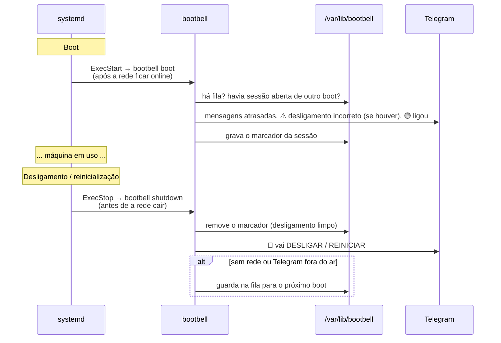

<div align="center">

# 🔔 bootbell

**Receba um aviso no Telegram sempre que o seu computador ligar, desligar ou reiniciar.**

[](https://github.com/AprendendoLinux/bootbell/actions/workflows/ci.yml)
[](https://github.com/AprendendoLinux/bootbell/releases/latest)
[](LICENSE)


</div>

---

O **bootbell** é um serviço pequeno para Linux (systemd) que manda uma mensagem
para você no Telegram quando a máquina **liga**, **desliga** ou **reinicia**.
Ele também avisa quando a máquina **não foi desligada direito** (queda de
energia, travamento, botão de desligar segurado). Assim você fica sabendo de
quedas no servidor de casa, no computador da família ou na máquina do
escritório.

```text
🟢 O computador servidor-casa foi LIGADO em 19/11/2026 às 07:58:25.

Endereços IP:
• enp3s0: 192.168.0.10, 2001:db8:20::2
```

```text
🔴 O computador servidor-casa vai REINICIAR em 19/11/2026 às 23:41:07.
Ficou ligado por 15 horas e 42 minutos.
```

```text
⚠️ O computador servidor-casa NÃO foi desligado corretamente.
A sessão iniciada em 18/11/2026 às 08:02:11 terminou sem um desligamento
normal (queda de energia, travamento ou desligamento forçado).
```

## Índice

- [Recursos](#recursos)
- [Compatibilidade](#compatibilidade)
- [Instalação](#instalação)
- [Configuração](#configuração)
- [Uso](#uso)
- [Como funciona](#como-funciona)
- [Segurança](#segurança)
- [Solução de problemas](#solução-de-problemas)
- [Atualização e remoção](#atualização-e-remoção)
- [Migrando de scripts caseiros](#migrando-de-scripts-caseiros)
- [Desenvolvimento](#desenvolvimento)
- [Licença](#licença)

## Recursos

| | |
|---|---|
| 🟢 **Ligou** | Aviso com hostname e endereços IP de cada interface. |
| 🔴 **Desligou / reiniciou** | Diz se a máquina vai **desligar** ou **reiniciar** e há quanto tempo estava ligada. |
| ⚠️ **Desligamento incorreto** | No boot, avisa se a sessão anterior terminou sem um desligamento normal. |
| 📨 **Nada se perde** | Sem rede na hora do desligamento? O aviso fica guardado e sai no próximo boot. |
| ⏱️ **Não atrasa o boot** | O envio acontece em segundo plano e tenta de novo até a rede funcionar. |
| ✏️ **Mensagens suas** | Todos os textos podem ser personalizados no arquivo de configuração. |
| 🔒 **Seguro** | Roda como usuário sem privilégios, com o serviço systemd endurecido; o token fica num arquivo que só root lê. |
| 🪶 **Leve** | Um único script Python, só com a biblioteca padrão. Nenhuma dependência extra. |

## Compatibilidade

O pacote `.deb` é testado automaticamente no CI, instalando e removendo o
pacote em cada uma destas versões:

| Distribuição | Versões |
|---|---|
| **Debian** | 10 (buster), 11 (bullseye), 12 (bookworm), 13 (trixie) e posteriores |
| **Ubuntu** | 18.04, 20.04, 22.04, 24.04 e posteriores |
| **Linux Mint** | 19, 20, 21, 22 e LMDE 4, 5, 6 e posteriores |

Requisitos mínimos: **Python 3.6** e **systemd 237**. Também funciona em outras
distribuições baseadas em Debian e Ubuntu que atendam a esses requisitos (Pop!_OS,
elementary OS, Zorin, Raspberry Pi OS etc.).

## Instalação

Baixe o pacote da [última release](https://github.com/AprendendoLinux/bootbell/releases/latest)
e instale com o `apt`, que resolve as dependências sozinho:

```bash
wget https://github.com/AprendendoLinux/bootbell/releases/latest/download/bootbell_1.0.0_all.deb
sudo apt install ./bootbell_1.0.0_all.deb
```

> **Ubuntu 18.04 / Debian 10:** se o seu `apt` for antigo e não aceitar um
> caminho de arquivo, use `sudo dpkg -i bootbell_1.0.0_all.deb && sudo apt-get -f install`.

O pacote instala:

| Caminho | O que é |
|---|---|
| `/usr/bin/bootbell` | o programa |
| `/etc/bootbell/bootbell.conf` | a configuração (preservada nas atualizações) |
| `/usr/lib/systemd/system/bootbell.service` | o serviço systemd (já habilitado) |
| `/var/lib/bootbell/` | estado interno (marcador de sessão e fila) |
| `man bootbell` | o manual |

## Configuração

### 1. Crie um bot no Telegram

1. No Telegram, abra uma conversa com o [@BotFather](https://t.me/BotFather).
2. Envie `/newbot`, escolha um nome e um usuário (terminado em `bot`).
3. O BotFather responde com o **token**, algo como `123456789:AAH...`. Guarde-o.

### 2. Descubra o seu chat ID

1. Mande qualquer mensagem para o seu bot novo (por exemplo, `oi`).
2. Abra no navegador, trocando `<TOKEN>` pelo token do passo anterior:
   `https://api.telegram.org/bot<TOKEN>/getUpdates`
3. Procure por `"chat":{"id":123456789` — esse número é o seu **chat ID**.

> Para receber os avisos num **grupo**, adicione o bot ao grupo, mande uma
> mensagem lá e repita o passo 2. O ID de grupos começa com `-`.

### 3. Edite a configuração

```bash
sudo nano /etc/bootbell/bootbell.conf
```

```ini
[telegram]
token = 123456789:AAH...
chat_id = 123456789
```

### 4. Teste e ative

```bash
sudo bootbell check                # valida e mostra uma prévia das mensagens
sudo bootbell test                 # envia uma mensagem de teste
sudo systemctl start bootbell      # ativa o monitoramento agora
```

Pronto! A partir do próximo boot tudo é automático.

### Todas as opções

O arquivo [`bootbell.conf`](packaging/bootbell.conf) é comentado e explica cada
opção. Resumo:

| Seção | Opção | Padrão | Descrição |
|---|---|---|---|
| `[telegram]` | `token` | — | Token do bot (obrigatório). |
| | `chat_id` | — | Chat que recebe os avisos (obrigatório). |
| | `silent` | `no` | Envia sem som de notificação. |
| | `api_url` | `https://api.telegram.org` | Para quem usa um servidor próprio da Bot API. |
| `[general]` | `hostname` | hostname do sistema | Nome do computador nas mensagens. |
| | `date_format` | `%d/%m/%Y` | Formato da data (`strftime`). |
| | `time_format` | `%H:%M:%S` | Formato da hora (`strftime`). |
| | `ignore_interfaces` | `docker* veth* br-* virbr* lxcbr* lxdbr*` | Interfaces que não aparecem na lista de IPs. |
| | `ipv4_only` | `no` | Fala com o Telegram somente por IPv4. |
| | `request_timeout` | `10` | Tempo máximo de cada tentativa, em segundos. |
| | `boot_retry_for` | `300` | Por quanto tempo tentar enviar no boot. |
| | `shutdown_timeout` | `20` | Tempo máximo para enviar no desligamento. |
| `[messages]` | `boot`, `shutdown`, `unclean`, `started`, `stopped`, `test`, `delayed` | textos em português | Modelos das mensagens. |

### Personalizando as mensagens

Os modelos aceitam estes campos. Use `\n` para quebrar linha:

| Campo | Conteúdo |
|---|---|
| `{host}` | nome do computador |
| `{date}` / `{time}` | data e hora do evento |
| `{uptime}` | tempo ligado, ex.: `2 dias, 3 horas e 5 minutos` |
| `{ips}` | endereços IP, um por linha, agrupados por interface |
| `{action}` | `REINICIAR` ou `DESLIGAR` (só em `shutdown`) |
| `{last_boot}` | início da sessão interrompida (só em `unclean`) |
| `{version}` | versão do bootbell |

Exemplo:

```ini
[messages]
boot = ✅ {host} está no ar ({date} {time})\n{ips}
shutdown = 💤 {host} vai {action}. Uptime: {uptime}
```

Rode `sudo bootbell check` para ver como as mensagens vão ficar.

## Uso

```text
bootbell [-c ARQUIVO] [--state-dir DIR] [-n] COMANDO

Comandos:
  boot       avisa que o computador ligou (usado pelo systemd)
  shutdown   avisa que o computador vai desligar (usado pelo systemd)
  test       envia uma mensagem de teste
  check      valida a configuração e mostra uma prévia das mensagens

Opções:
  -c, --config ARQUIVO   arquivo de configuração (padrão: /etc/bootbell/bootbell.conf)
  --state-dir DIR        diretório de estado (padrão: /var/lib/bootbell)
  -n, --dry-run          mostra as mensagens em vez de enviá-las
  -V, --version          mostra a versão
```

No dia a dia você só usa `test`, `check` e os comandos do systemd:

```bash
systemctl status bootbell          # estado do serviço
journalctl -u bootbell             # histórico de envios e erros
journalctl -u bootbell -b -1       # o que aconteceu no boot anterior
sudo systemctl disable bootbell    # desativa os avisos a partir do próximo boot
```

## Como funciona



Alguns detalhes:

- **Desligamento incorreto.** No boot, o bootbell grava um marcador com o
  `boot_id` do kernel. Num desligamento normal, o systemd roda o `ExecStop` e o
  marcador é apagado. Se no boot seguinte o marcador de *outro* boot ainda
  existir, a sessão anterior terminou de forma anormal.
- **Reiniciar ou desligar.** Durante o desligamento, o bootbell consulta os
  jobs pendentes do systemd (`reboot.target`, `poweroff.target`...).
- **Boot ou ativação manual.** Pelo estado do systemd (`starting` ou `running`),
  ele sabe se foi iniciado pelo boot ou à mão. No segundo caso, a mensagem é
  "monitoramento ativado", não "ligou". O mesmo vale para `systemctl stop`.
- **Sem atrasar o boot.** O serviço é `Type=simple` com `RemainAfterExit=yes`:
  o boot segue enquanto o envio tenta de novo (com espera crescente) por até
  `boot_retry_for` segundos.
- **Ordem no desligamento.** A unit declara `After=network-online.target
  nss-lookup.target dbus.service`. Por isso o systemd para o bootbell *antes*
  da rede, do DNS e do D-Bus, e o aviso ainda consegue sair.

## Segurança

- O serviço roda como o usuário de sistema **`bootbell`**, sem shell e sem home,
  com `NoNewPrivileges`, `ProtectSystem=strict`, `ProtectHome`, `PrivateTmp`,
  `PrivateDevices` e outras proteções do systemd.
- `/etc/bootbell/bootbell.conf` fica com permissão **640** (`root:bootbell`):
  só o root e o serviço leem o token. O `bootbell check` avisa se o arquivo
  estiver legível por todos.
- O token **nunca** aparece nos logs nem na saída dos comandos.
- Se o seu token vazar, revogue-o no @BotFather (`/revoke`) e coloque o novo
  no arquivo de configuração.

## Solução de problemas

<details>
<summary><b>O <code>bootbell test</code> diz "sem permissão para ler"</b></summary>

O arquivo de configuração só pode ser lido pelo root. Use `sudo bootbell test`.
</details>

<details>
<summary><b>"o Telegram respondeu HTTP 401: Unauthorized"</b></summary>

O token está errado ou foi revogado. Confira com o @BotFather (`/mybots`).
</details>

<details>
<summary><b>"o Telegram respondeu HTTP 400: Bad Request: chat not found"</b></summary>

O `chat_id` está errado ou você ainda não mandou nenhuma mensagem para o bot
(um bot não pode iniciar uma conversa). Mande um `oi` para o bot e tente de novo.
</details>

<details>
<summary><b>O aviso de desligamento não chega</b></summary>

- Veja o que houve no boot anterior: `journalctl -u bootbell -b -1`.
- Se a rede cai muito cedo (ex.: Wi-Fi gerenciado pela sessão do usuário),
  o aviso fica na fila e chega no próximo boot com a nota "entregue com atraso".
- Se o IPv6 da sua rede não funciona direito, use `ipv4_only = yes`.
</details>

<details>
<summary><b>O aviso de "ligou" demora a chegar</b></summary>

O bootbell espera o `network-online.target`. Se a sua distribuição não tiver o
serviço de espera da rede habilitado, ele começa antes e fica tentando de novo.
Confira com `systemctl is-enabled NetworkManager-wait-online systemd-networkd-wait-online`.
</details>

<details>
<summary><b>Aparecem IPs de Docker, VPN ou máquinas virtuais</b></summary>

Acrescente as interfaces em `ignore_interfaces` (aceita `*` e `?`), por exemplo
`ignore_interfaces = docker* veth* br-* virbr* tun* wg*`.
</details>

## Atualização e remoção

```bash
sudo apt install ./bootbell_<nova-versão>_all.deb   # atualiza; sua configuração é mantida
sudo apt remove bootbell                            # remove; mantém a configuração
sudo apt purge bootbell                             # remove tudo, inclusive a configuração
```

Nas atualizações o serviço **não é reiniciado**, para não gerar avisos falsos.
O código novo passa a valer no próximo desligamento. Na remoção, o serviço é
parado e você recebe o aviso "monitoramento desativado".

## Migrando de scripts caseiros

Se você usava uma unit com `ExecStart=/usr/local/bin/ligou.sh` e
`ExecStop=/usr/local/bin/desligou.sh` (ou algo parecido) com `curl`:

```bash
# 1. Instale e configure o bootbell (seções acima) e confira:
sudo bootbell test

# 2. Remova a solução antiga sem disparar o aviso antigo de "desligou":
sudo systemctl disable robozinho.service
sudo rm /usr/local/bin/ligou.sh /usr/local/bin/desligou.sh /etc/systemd/system/robozinho.service
sudo systemctl stop robozinho.service; sudo systemctl reset-failed robozinho.service
sudo systemctl daemon-reload

# 3. Ative o bootbell:
sudo systemctl start bootbell
```

Se o token estava escrito nos scripts, troque-o (`/revoke` no @BotFather).

## Desenvolvimento

```text
bootbell/
├── src/bootbell.py              # o programa (instalado como /usr/bin/bootbell)
├── packaging/
│   ├── bootbell.conf            # configuração padrão
│   ├── bootbell.service         # unit do systemd
│   └── debian/                  # control, maintainer scripts, changelog, copyright
├── docs/bootbell.1              # página de manual
├── tests/
│   ├── test_bootbell.py         # testes unitários (sem rede)
│   └── install-test.sh          # instala o .deb num container e testa
├── build-deb.sh                 # gera o .deb em dist/
└── .github/workflows/ci.yml     # testes, build, instalação em 8 distros e release
```

```bash
# Testes unitários
python3 -m unittest discover -s tests -v

# Testes em uma versão específica do Python (ex.: a mínima suportada)
docker run --rm -v "$PWD":/src:ro -w /src python:3.6-slim python3 -m unittest discover -s tests

# Gerar o pacote (só precisa de dpkg-deb)
./build-deb.sh

# Instalar e testar o pacote numa distro
docker run --rm -v "$PWD":/src -w /src ubuntu:18.04 sh tests/install-test.sh

# Rodar sem enviar nada
./src/bootbell.py -c minha.local.conf --state-dir /tmp/bb --dry-run boot
```

**Regra de ouro:** o código precisa continuar rodando no **Python 3.6**, só com
a biblioteca padrão. O CI testa de 3.6 a 3.13.

### Publicando uma versão

1. Atualize `__version__` em `src/bootbell.py`, `packaging/debian/changelog`,
   `CHANGELOG.md` e a data em `docs/bootbell.1`.
2. Faça o commit e crie a tag: `git tag -a v1.2.3 -m "bootbell 1.2.3" && git push --follow-tags`.
3. O CI testa, gera o `.deb`, instala em todas as distros e publica a release
   com o pacote e o `SHA256SUMS`.

## Licença

[MIT](LICENSE) © 2026 AprendendoLinux
